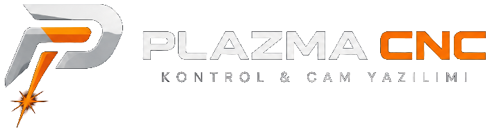

<p align="center"></p>

# Plasma Kontrol — Plazma CNC Kontrol ve CAM Yazılımı

FluidNC tabanlı plazma CNC makineleri için **tek pencerede** çizim (CAM), sac yerleşimi (nesting) ve makine kontrolü.
[OpenBuilds CONTROL](https://github.com/OpenBuilds/OpenBuilds-CONTROL) ve [OpenBuilds CAM](https://github.com/OpenBuilds/OpenBuilds-CAM) üzerine geliştirilmiştir; plazma kesim için gereken eksik özellikler eklenmiştir.

> ⚠️ Plazma kesim tehlikelidir. İlk denemeleri torç kapalıyken (Kuru Çalıştır, Çerçeve Gez) yapın ve G-code'u kontrol edin. Yazılım "olduğu gibi" sunulur, hiçbir garanti verilmez.

## İndir

Windows (64 bit): **[Releases](../../releases)** sayfasından `PlasmaKontrol-win64-*.zip` dosyasını indirin, bir klasöre açın ve `PlasmaKontrol.exe`'yi çalıştırın. Kurulum gerekmez.

## Öne çıkan özellikler

**Çizim (CAM)**
- DXF / SVG içe aktarma (DXF dairelerindeki kapanma ve kaydetme hataları düzeltildi)
- Çizim araçları: çizgi, dikdörtgen (köşe yarıçaplı), daire, yay, çokgen, kanal; ızgara ve noktaya yapışma, ölçüyle çizim
- **Ölçekle**: şekli köşesinden tutup büyüt/küçült (oranlı veya serbest), kenarından esnet, sürükleyerek taşı; panelden kesin ölçü
- Düğüm düzenleme, **kırp (trim)**, birleştir, köşe yuvarlat, ofset, kopyala, dizi, dairesel dizi
- Parametrik şekiller: ölçüler sonradan değiştirilebilir, toolpath ve G-code kendiliğinden güncellenir
- Aynalama, 9 noktadan sıfır seçimi, torca hizalama
- **Malzeme kütüphanesi (kesim tablosu)**: malzeme/kalınlık seçince kerf, hız, delme ve kesim yüksekliği gelir
- **Mikro bağlantı (köprü)**: küçük parçalar ızgaralı tablaya düşmesin
- **Toolpath başına kesim ayarları**: lead-in (yay / düz / kapalı) ve lead-out (bindirme / yay / kapalı) ayrı uzunluklarla, kesim yönü, küçük delik yavaşlatma; delme noktası ve giriş/çıkış önizlemede görünür
- **Makine profilleri**: ayarları isimle kaydet (ör. Plazma, Router), açılışta listeden seç
- Plazma G-code: ayarlanabilir torç kapama (`M3 S0`), FluidNC uyumlu IHS dizisi, yay lead-in, kontur sonu bindirme, küçük delik yavaşlatma

**Nesting (sac yerleşimi)**
- Gerçek şekil yerleşimi, serbest döndürme, delik içine parça
- Standart sac + artık saclar, gerektiğinde 2., 3. sac
- Sac sekmeleri (Kesilecek / Kesildi / Hariç), parça dışlama
- Kesim sırası: parça parça (önce delikler) veya elle; delik içindeki parça her zaman önce kesilir

**Makine kontrolü (FluidNC)**
- CAM'den tek tuşla G-code gönderme
- **Sac hizalama**: iki noktayla sacın köşesi ve eğikliği; G-code otomatik döndürülür
- **Artık sac tanıtma**: torcu artığın köşelerinde gezdirerek şeklini nesting'e aktarma
- **İş öncesi kontrol**: torç açık kalma, sac/makine sınırı aşımı, eksik IHS, hız; delme sayısı ve tahmini süre
- **Kaldığı yerden devam**: ark sönerse torcun konumuna en yakın noktadan IHS + delmeyle devam
- Çerçeve Gez (önce güvenli Z), Kuru Çalıştır (torç ateşlenmez)
- Hazır makrolar: torç testi, yoklama testi, Z sıfırlama (IHS)
- Otomatik güncelleme kapalı (resmi OpenBuilds sürümüyle değiştirilmez)

Ayrıntılı kullanım ve makinede ilk test sırası: **[PLAZMA.md](PLAZMA.md)**

## Kaynaktan çalıştırma

```bash
npm install
npx electron .
```

Windows paketi (`dist-plazma/win-unpacked/PlasmaKontrol.exe`):

```bash
npx electron-builder --win --x64 --dir -c.directories.output=dist-plazma -c.win.signAndEditExecutable=false --publish never
```

Portlar: kontrol arayüzü `3100`, CAM `3110` (resmi OpenBuilds CONTROL ile aynı anda çalışabilir).

## Lisans ve atıf

Bu proje açık kaynaklı **OpenBuilds CONTROL** ve **OpenBuilds CAM** üzerine kuruludur. Orijinal telif ve lisans bildirimleri korunmuştur:
- OpenBuilds CONTROL: kökteki [LICENSE](LICENSE) (GPL-3.0; `package.json`: AGPL-3.0)
- OpenBuilds CAM: [cam/LICENSE](cam/LICENSE) (AGPL-3.0)

OpenBuilds adı ve logoları OpenBuilds'e aittir; bu proje OpenBuilds ile bağlantılı değildir. Orijinal proje açıklaması: [README-OpenBuilds.md](README-OpenBuilds.md).
